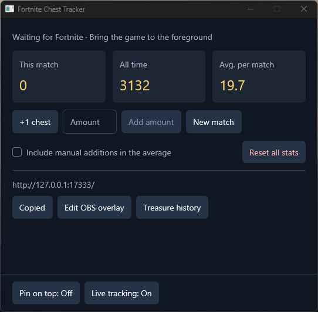

# Fortnite Chest Tracker

A Windows app that counts chests and ammo crates and shows your current match, all-time total, and average per match. Stats save automatically.

## Play

1. Open `fortnite-chest-tracker.exe` and play Fortnite in **English** and **Windowed Fullscreen**.
2. Enable **Record Replays** in Fortnite so the tracker can check your count after each match. You can turn **Live tracking** off and still use replays.
3. Use **+1 chest** or **Add amount** to correct a count. Check **Include manual additions in the average** before adding if you want those counts included.

Use **Pin on top** to show just the stat cards over the game, or **Treasure history** to see details from replays. Use **New match** if the tracker misses the start of a match.

**Reset all stats → Use replays** replaces your lifetime total and average using up to your latest **100 completed replays**.

## OBS

Add a **Browser** source in OBS, leave **Local file** unchecked, and paste the URL from **Copy OBS URL**. Start with **440 × 100** and keep the tracker open.

Use **Edit OBS overlay** to style the cards or write custom text with `{match}`, `{total}`, and `{average}`.

## Build from source

Install Rust for Windows (MSVC) and Visual Studio Build Tools with the C++ workload and Windows SDK. Run `cargo build --release --locked`, then open `target\release\fortnite-chest-tracker.exe`.

For replay support, install the .NET 10 SDK and Git, then run `pwsh -File replay-tools/build-native.ps1`. The decoder uses [LED-N’s Fortnite ChestCounter](https://github.com/LED-N/Fortnite-ChestCounter).

## License

Released under the [MIT License](LICENSE). The replay decoder is built from [LED-N’s Fortnite ChestCounter](https://github.com/LED-N/Fortnite-ChestCounter) (MIT) and Shiqan’s FortniteReplayDecompressor (MIT); their license files are copied next to the built decoder by `build-native.ps1` and must be kept with any distributed build.

## Disclaimer

This project is not affiliated with or endorsed by Epic Games, Inc. Fortnite is a trademark of Epic Games, Inc.
